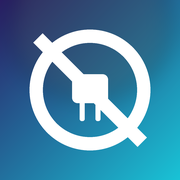

# Tetherless

### Sideload on iPhone. No computer. Ever.

Sign and install apps right on your iPhone — **no Mac, no PC, no cable, and no jailbreak.**
Everything happens on the device in your hand.

[**Download**](https://github.com/pwnapplehat/TetherlessiOS/releases/latest) · [Website](https://tetherlessios.com)

---

## What it does

- **Sign & install any IPA** — using your free Apple ID, or your own certificate.
- **Get a clean copy of apps you own** — download an app you already own from the App Store and produce a DRM-free copy, fully on-device.
- **Multiple App Store accounts** — sign several Apple IDs in for downloads and switch between them right in the Decrypt tab.
- **Tweak injection** — add `.deb` or `.dylib` tweaks while you sign.
- **Keep apps alive** — resign in one tap, **Refresh All** at once, or **automate it with a Shortcut** so your apps (and Tetherless itself) never expire — even while your iPhone is locked.
- **Built-in Files** — manage IPAs, tweaks, and downloads without leaving the app.
- **Custom certificate mode** — bring your own paid certificate to install over the air, with no pairing or VPN.
- **Manage your Apple ID** — view your signing certificates, App IDs, and devices, and revoke a certificate to free a slot — right in the app, no Apple Developer portal needed.

## Download

| Build | For | |
|-------|-----|---|
| **Modern** | iOS 26 and later | [Download](https://github.com/pwnapplehat/TetherlessiOS/releases/latest) |
| **Legacy** | iOS 17.4 – 18.x.x | [Download](https://github.com/pwnapplehat/TetherlessiOS/releases/latest) |

Not sure? If your iPhone is on **iOS 26 or newer**, pick **Modern**. Otherwise pick **Legacy**.

## Requirements

- An iPhone on **iOS 17.4 or later**.
- For **free Apple-ID signing**: the free **LocalDevVPN** app from the App Store (used for the on-device connection), plus a one-time pairing.
  - On-device “Pair with…” needs **iOS 27**. On iOS 17.4 – 26, import a pairing file instead (made with a tool like iPASide or iLoader).
- For **custom-certificate mode**: just your own `.p12` + `.mobileprovision` — no pairing, no VPN.

## Getting started

1. **Download & install** the build that matches your iOS, and put Tetherless on your iPhone.
2. **Pair your iPhone** (one-time) in the Pair tab — or bring your own certificate in Settings and skip pairing entirely.
3. **Add an app** — import an IPA in the Library, or download a clean copy of one you own from the Decrypt tab.
4. **Sign & install** — tap sign, tap install, and it lands on your Home Screen. Resign anytime to keep it.

## Good to know

- Apps signed with a **free Apple ID** stay valid for **7 days** — tap **Resign** on one app, **Refresh All** to do every app at once, or set up the automation below so you never have to think about it. A paid certificate lasts a year.
- Tetherless keeps **itself** signed too, so the app doesn’t fall off your Home Screen.
- Only install apps you own or have the right to use.

### Automatic refresh — set it and forget it

Free signing expiring every 7 days is the one chore of sideloading. Tetherless can do it for you on a schedule, in the background, with the **Shortcuts** app:

1. In **Shortcuts → Automation**, create a **Personal Automation** → **Time of Day** (e.g. overnight, every few days). Set it to **Run Immediately**.
2. Add the **Enable LocalDevVPN** action (with your Tunnel IP / Device IP).
3. Add Tetherless’s **Refresh All Apps** action after it.

That’s it. On schedule it brings the connection up and re-signs every sideloaded app — and Tetherless itself — then sends you a notification. It works even with your iPhone **locked**, so nothing ever expires. (There’s also a **Refresh All** button in Library → Installed to do it by hand any time.)

Open Tetherless once after installing so it can finish setting up; keep **LocalDevVPN** installed and your Apple ID signed in. If Apple ever signs you out, just sign in again — that one step can’t be automated.

### Decrypting apps — one-time App Store sign-in

To decrypt an app you own, the Apple ID you use in Tetherless must have been **signed in to this iPhone’s App Store at least once** — open the **App Store app** (or **Settings → your name → Media & Purchases**) and sign in with it one time.

This is a **one-time step per Apple ID**: iOS stores that account’s decryption keys the first time it signs in and keeps them, so afterward you can switch your active App Store account back and decrypting still works. The account also has to **own the app** (be able to get it from the App Store).

Without that one-time sign-in, decrypting fails *after* the download, because the device has no keys for that account — nothing is wrong with Tetherless or your setup.

---

Tetherless is not affiliated with Apple Inc. “iPhone”, “iOS”, and “App Store” are trademarks of Apple Inc.

